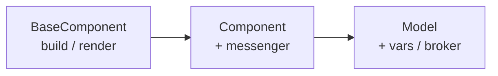

# JAML® Component Layer

The component layer is the engine that parses JAML objects, creates elements, and manages lifecycle, reactivity, and messaging.



Start with `BaseComponent` for pure element building. Upgrade to `Component` for messenger-reactive UIs. Use `Model` as the top-level root of any JAML-rendered UI.

> **See also:** [JAML Format Reference](./jaml-format.md) for control keys and element params. [Binders & Messaging](./binder.md) for the binder syntax and broker system.

---

## Global Entry Points

Three globals are registered at startup:

| Global | Signature                            | Returns                  | Use when                                             |
| ------ | ------------------------------------ | ------------------------ | ---------------------------------------------------- |
| `jaml` | `jaml(container, option)`            | `Model` easyAccess proxy | Render a reactive JAML UI                            |
| `jame` | `jame(option)`                       | `HTMLElement`            | Build a static element — no reactivity, no messaging |
| `jamd` | `jamd(container, markdown, option?)` | `Model`                  | Render a Markdown document                           |

For retained auxiliary panels and file previews, see [`jaml.drawer` and `jaml.previewer`](drawer-and-previewer.md). Both return definitions; mounting and lifetime remain with their owning component or modal.

### Core `jaml.*` API

| Method                                      | Description                                                                | See                                                                 |
| ------------------------------------------- | -------------------------------------------------------------------------- | ------------------------------------------------------------------- |
| `jaml(container, option)`                   | Render a reactive JAML UI                                                  | Below                                                               |
| `jaml.<type>(...)`                          | Easy builder for any element type                                          | [Easy Builders](#easy-builders--jamltype)                           |
| `jaml.json(data, options?, jamlOverride?)`  | Convert any JS object into a component tree                                | [`jaml.json()`](#jamljson--render-json-as-jaml)                     |
| `jaml.md(content, options?, jamlOverride?)` | Parse Markdown into a component option                                     | [`jaml.md()`](#jamlmd--markdown-as-component-option)                |
| `jaml.register(name, option)`               | Register a custom component (CC)                                           | [Custom Components](#custom-components-cc)                          |
| `jaml.register(definition)`                 | Register a complete CC Definition and its variant styles                   | [CC Definitions](#cc-definitions)                                   |
| `jaml.cc.*(...)`                            | Build conventional title, subtitle, and indicator nodes for CC Definitions | [CC builders](#cc-builders)                                         |
| `jaml.registerUsage(name, option)`          | Register a reusable action preset                                          | [`jaml.registerUsage()`](#jamlregisterusage--custom-usages)         |
| `jaml.var(key, cb?)`                        | JS-first reactive binder builder                                           | [Binder syntax](./binder.md#jamlvar-programmatic-binder)            |
| `jaml.bunch(target, builder)`               | JS-first loop builder (equivalent of `buildFor`)                           | [`buildFor`](./jaml-format.md#buildfor)                             |
| `jaml.res(fn)`                              | Mark a function as a lazy param resolver                                   | [Element params](./jaml-format.md#jamlres--lazy-param-resolver)     |
| `jaml.pre(value)`                           | Preserve a value from binder evaluation                                    | [Binder syntax](./binder.md#jamlpre--preserve-a-value-from-binding) |

---

## Final JAML overrides

On development runtimes with the unified builder override contract, structured builders accept an optional final `jamlOverride` for the returned root. Builder inputs describe content and behavior; the final override supplies root IDs, attributes, bindings, styles, plugins and caller hooks. Verify runtime support before migrating an older installation.

| Builder                            | Signature                                                               |
| ---------------------------------- | ----------------------------------------------------------------------- |
| Page, application, sidebar, drawer | `jaml.<builder>(layout, jamlOverride?)`                                 |
| Theme panel                        | `jaml.themePanel(options?, jamlOverride?)`                              |
| Previewer                          | `jaml.previewer(resource, options?, jamlOverride?)`                     |
| Git diff                           | `jaml.gitdiff(content, options?, jamlOverride?)`                        |
| Confirmation content               | `jaml.yesNoDialog(prompt, yes?, no?, styles?, options?, jamlOverride?)` |
| CC helpers                         | `jaml.cc.<helper>(options?, classOrStyles?, jamlOverride?)`             |
| Markdown                           | `jaml.md(content, options?, jamlOverride?)`                             |
| JSON                               | `jaml.json(content, options?, jamlOverride?)`                           |

Keep the documented argument positions: an override is not detected merely because it is the last object supplied. For example, use `jaml.previewer(resource, {}, override)` to leave preview options at their defaults; `jaml.previewer(resource, override)` supplies preview options instead. Use `{}` or `undefined` for an omitted options argument and `[]` or `undefined` for an omitted styles argument. Existing positional arguments retain their meanings. Markdown/JSON still accept legacy root customization in `options`; the final override applies afterward. Legacy JSON depth/caption arguments remain accepted as `jaml.json(content, options, depth, cap?, jamlOverride?)`; normal composition does not need them. Generic element builders already accept a final JAML object and have no separate generated structure to protect.

Choose the customization target before writing the override:

| Intended change                                                  | Where it belongs                                                                                                                                                                                                                                        |
| ---------------------------------------------------------------- | ------------------------------------------------------------------------------------------------------------------------------------------------------------------------------------------------------------------------------------------------------- |
| Content, business behavior or a generated region                 | The builder's named inputs: for example, drawer `content`/`drawer`, sidebar `nav`/`footer`, or previewer `actions`.                                                                                                                                     |
| Returned root's ID, attributes, styles, bindings or caller hooks | The final `jamlOverride`. Pass it to the builder so its merge and hook composition run. Spreading over the returned definition or assigning its hooks afterward bypasses those protections.                                                             |
| Additional children of that root                                 | A top-level `components` array in the final override. It appends after generated children; it does not recursively patch a generated region. Native slots may place an addition when the returned host supports them and the addition fits its purpose. |

This document keeps its rendered Markdown, adds a draft note after it, and runs caller diagnostics alongside its existing lifecycle. It needs no extra container just to hold the root ID or height:

```javascript jaml-playground
export default jaml.md(
    '# Notes\n\nThe renderer retains its own content and lifecycle.',
    { buildToc: false },
    {
        id: 'notes-document',
        attrs: { 'aria-label': 'Notes' },
        styles: ['css(height:16rem;flexDirection:column)'],
        components: [{ type: 'label', cap: 'Local draft' }],
        onafterrender() {
            console.info('Notes rendered');
        },
        onunmount() {
            console.info('Notes unmounted');
        }
    }
);
```

The merge does not mutate caller options. Across structured builders, a top-level final override `components` array concatenates after generated children in a new array; an empty array preserves them. If there are no generated children, the supplied children are still copied into a new array. Use an explicit array, not a binding, loader or function. `params.components`, reflected component attributes and suffixed component properties remain blocked because they bypass concatenation. Undefined properties leave defaults intact. Ordinary properties replace defaults; supported maps merge by key, while styles/plugins append after required entries. Watchers accept the native array or callback-map form and append to existing watchers. Selector style maps retain required entries. Existing classes are retained alongside caller classes. Internal method/property/variable keys and framework-owned attributes cannot be replaced; additional keys are allowed.

Generated structure stays with the builder: `type`, `element`, `buildFor`, `dataUrl` and `bunchBuilder` cannot change that ownership. The same type is allowed, and an existing semantic role can select a compatible variant. Renderer-owned broker/binding settings, preview resource methods/properties and theme-panel identity remain protected. Alternate paths through nested `params`, reflected attributes or suffixed property names cannot replace protected state or required style/plugin collections. Put supported customization in the top-level final override; errors name the conflicting property. Arbitrary CSS and callback code remain caller responsibilities.

No builder lifecycle is added. A caller hook with no builder counterpart passes through. When a builder already owns the hook, supply a function: its existing handler runs first with the same receiver and arguments, then the caller handler. Existing synchronous dispatch is preserved; returned promises do not introduce waiting. For native unmount/destroy hooks, caller notification is retained through `finally`; caller failure cannot skip the builder cleanup that ran first. Initialization failure does not run a caller success hook. Dialog keyboard behavior likewise runs before its appended caller handler. Native mount/unmount/destroy subscriptions installed by a builder remain attached.

Use the named builder inputs to customize an existing internal region. The final override does not search descendants or infer a new region from an appended child. An empty `components` array keeps generated children; it is not a clearing operation. If the required structure is outside the builder's contract, choose another composition rather than bypassing a protection error. In particular, [sidebar overrides](#sidebar-builder-and-application-integration) target the sidebar root independently of the application's final root override.

## Read-only Git diff builder

`jaml.gitdiff({ before, after, language? }, options?, jamlOverride?)` displays a single-file comparison through the optional input-code bundle. Both documents are literal strings. Git access, file/revision selection, finding validation and stale-source policy belong to the caller. Standalone source previews are separate capabilities.

Options include `mode: 'unified' | 'split'` (default unified), `lineWrapping` (default true), `syncScroll` (default true), `collapseUnchanged: false | { margin?, minSize? }` (default margin 3/minSize 4), and `scrollToChange` (default true). Synchronized split mode uses one shared vertical viewport; false gives each pane independent scrolling. Unified gutters show paired old/new numbers with at least four digits per column. `beforeLabel`, `afterLabel` and `unchangedLabel` support localization; the unchanged label uses `$` for its line count.

For comparisons that supply only changed regions, use `{ hunks, language? }` instead of document strings. Each hunk is `{ oldStart, oldLines, newStart, newLines, lines }`; each entry in `lines` is one physical line prefixed with a space (context), `-` (removed) or `+` (added). Counts must match those rows, and spans must be ordered and nonoverlapping on both sides. Starts/counts must be safe integers; nonempty spans start at one or above, while zero-count spans anchor after a nonnegative start. An optional `\ No newline at end of file` entry annotates the preceding row. Do not mix hunks with `before`/`after` fields.

Supplied change markers remain authoritative. Hunk views preserve original line numbers and show permanent headers with omitted-context notices; `omittedLabel` customizes that notice. Missing lines cannot be expanded, and `collapseUnchanged` does not hide supplied context. No trailing omission is inferred. Empty hunks mean no supplied content, not proof of identical files. File existence, binary/oversized status and one-sided layout policy remain caller-owned. Hunk highlighting identifies changed lines; it does not promise word-level highlights.

In hunk mode, `selectRange` uses original source line numbers and rejects missing lines or ranges crossing an omitted gap. Unified selection targets after-source text; removed lines are displayed separately. Same hunk rows/coordinates and mode retain the mounted editors across preference changes. Changing input kind, hunk content or mode recreates them.

Use `fontSize` as a positive finite rem number, for example `1.125`. Without that option, typography inherits `--jam-git-diff-font-size` from the host, with a `0.875rem` fallback. Updating `fontSize` to `undefined` removes the explicit override. Language support includes Python (`py`), JSX (`javascriptreact`), TSX (`typescriptreact`), JavaScript and TypeScript, alongside the other input-code languages. Names are case-insensitive; unknown names fall back to plain text. Filename mapping remains caller-owned.

`onReady(view)` supplies the public handle after mounting; `onError(error)` handles mount/loading failures. The handle supports:

-   `update(content, options?)`: merge options and update the comparison.
-   `selectRange(range, { reveal? }?)`: select a range and return whether the request was accepted.
-   `destroy()`: release this viewer; repeated destruction is harmless.

A range is `{ side?: 'before' | 'after', from: { line, column? }, to: { line, column? } }`. Lines are one-based and columns are zero-based UTF-16 offsets. Start columns default to zero; the exclusive end defaults to the end of its line. Empty ranges and end-of-document cursors are valid. The default side is after; before-side selection requires split mode. Invalid/reversed/out-of-bounds ranges and unavailable/retired handles return false without changing selection. Calls are not queued before readiness. Hidden unchanged context intersecting the selection expands in both aligned panes. `reveal` defaults to `'center'`, centering the starting line even for a tall range; `'start'` aligns it at the top, and `false` selects/expands without explicit reveal. Programmatic reveal stays inside the viewer and does not steal focus.

```javascript jaml-playground
jaml.gitdiff(
    { before: 'const value = 1;\nexport { value };', after: 'const value = 2;\nexport { value };', language: 'JavaScript' },
    {
        fontSize: 0.875,
        onReady(view) {
            view.selectRange({ from: { line: 1 }, to: { line: 1 } });
        }
    },
    { id: 'example-diff', styles: ['css(height:18rem)'] }
);
```

For the same before/after strings, unchanged mode and effective collapse configuration, preference updates retain editor identity, selection and expanded context. Font, wrapping, synchronization, language and label changes preserve the top logical code block and its offset; reflow may change the numeric scroll position. Horizontal offsets survive where still reachable. Independent-to-shared scrolling uses the after pane's position; shared-to-independent scrolling retains the corresponding position in each pane. Later navigation or user input takes priority over a pending restoration.

Different documents, unified/split switches and collapse-configuration changes reset selection, expanded context and initial scrolling. `scrollToChange` controls construction/reset rather than navigating on every preference update. Unmount/remount recreates editors from the latest documents/options; it does not retain transient selection/scroll/context state. Explicit rerender retires the old handle. Review-specific source validation should run before calling `selectRange`; accepting a range only validates its coordinates.

## Logical component lookup before DOM

`model.findComponent(predicate)` searches logical components and can find a deferred row before its element exists. The predicate receives a raw component. This synchronous lookup does not wait for pending publication. For restoration immediately after inserting rows or revealing work, pass the predicate as `prepareScrollPosition`'s `row` request so native preparation resolves it after publication. Use `component.matchRef('transcript-row')` for a static ref and `component.getVarData('row')?.id` to read a loop alias; raw `component.props.row` is its declaration. Exclude virtual wrappers when selecting an actual row. The corrected development runtime activates `showIf`, `buildIf` and bound refs before deferred DOM construction; see [binding lifecycle](./binder.md#binding-lifecycle) and [targeted lazy restoration](../utils.md#targeted-lazy-scroll-preparation) for settlement and compatibility limits.

## `jaml` — render JAML UI

`jaml(container, option)` is the primary entry point. It parses the JAML option, builds the element tree, renders into `container`, and synchronously returns the `Model` instance. `await jaml(...)` or `await jam.render(...)` does not provide a readiness promise. See [render completion](./binder.md#binding-lifecycle) and [limited stability waits](../utils.md#jambasicallystableel). To supply external initial data before rendering, use the [construct → vars-write → render pattern](./binder.md#runtime-data-and-authored-definitions).

Destroy an owned view with `model.destroy()` when it is replaced or canceled; synchronous disposal after `render()` returns does not need an artificial delay. In the corrected development runtime, option-value publication still stores the value immediately, then broadcasts checked options after readiness only while the originating element/component and messenger remain alive. Destroyed or replaced controls cannot publish from that pending continuation. A detached but live control is still eligible. Readiness failures are reported for live controls and ignored after disposal. The host continues to own cancellation of its external requests and subscriptions; native cleanup does not cancel that work. See [element destruction hooks](../JAM-UI/JAM-UI.md#lifecycle-hooks) for receiver and teardown ordering, and verify the updated runtime before relying on these corrections.

`container` accepts an element ID string, a CSS selector, or an `HTMLElement`.

### Standalone application root

For a standalone full-page Jam application, render `jaml.application({ viewport: true, ... })` directly into `document.body`. The builder creates the `app` root and owns its layout; mount its result directly rather than wrapping it in another `app`.

```javascript
const model = jaml(
    document.body,
    jaml.application(
        {
            viewport: true,
            main: { components: [{ type: 'label', cap: '{{title}}' }] }
        },
        { vars: { title: 'Hello' } }
    )
);
model.vars.title = 'Updated'; // reactive — updates all bound {{title}} elements
```

The `app` role alone supplies presentation, not full-page geometry. A custom shell that does not use the application builder must own its display and dimensions explicitly. `size.fullsize` supplies parent-relative width and height, but requires a sized host and an appropriate display mode; it does not establish viewport ownership. Embedded application builders normally leave `viewport: false` and use the host's dimensions.

`jam.render(document.body, view)` follows the same mounting contract. Avoid gratuitous static `<main id="app">` or `<div id="app">` wrappers around a standalone app: theme recipes may target `body > .jam-app-style`, and an extra host breaks that boundary. `main` describes the primary semantic content inside the app; Electron does not require a static `<main>` mounting element. A splash or other intentionally separate body sibling does not require a wrapper around the app.

Set `stylize` in the JAML definition so the framework processes it and supplies `.jam-app-style`. A raw HTML `stylize="app"` attribute on a static element is not equivalent to rendering that JAML definition. Keep one app role for the standalone shell and retain content roles beneath it; see [layout-owned profiles](../Theme/stylize.md#layout-owned-stylize-profiles). A justified peer region outside the selected layout uses the explicit [composite-host pattern](#composite-application-hosts) below; it is not an incidental mounting wrapper.

### Sidebar builder and application integration

On development runtimes supporting `jaml.sidebar`, use `jaml.sidebar(layout, jamlOverride?)` to compose a sidebar. Its final argument customizes the sidebar root. `jaml.application(layout, jamlOverride?)` likewise accepts a final application-root override. Existing runtime versions may not include the sidebar builder; verify support before use.

| Sidebar layout input | Contract                                                                                                                                                                      |
| -------------------- | ----------------------------------------------------------------------------------------------------------------------------------------------------------------------------- |
| `nav`                | Required JAML option. Defaults to `stylize: 'nav'`; preserves the supplied element type, data, events and compatible variant such as `nav-tree`. No extra navigation wrapper. |
| `rail`               | Optional JAML option. Defaults to `nav-rail`; its contents, including supporting controls and a footer, remain caller-owned.                                                  |
| `header`, `footer`   | Optional JAML options for the contextual navigation area.                                                                                                                     |
| `section`            | Optional JAML override for the generated section. Requires `rail`; its `components` array appends after the generated header/nav/footer.                                      |

Without a rail, the sidebar directly contains the optional header, navigation and optional footer. With a rail, it contains the rail and a `section` grouping those same contextual regions. Widths, responsive visibility and rail contents remain caller choices. The layout arranges rail and section side by side, keeps contextual header/footer outside the navigation scroller, and gives the rail independent overflow. A rail's internal sticky or fixed controls require its own authored layout.

```text
sidebar                    sidebar
  header?                    nav-rail
  nav                        section
  footer?                      header?
                               nav
                               footer?
```

Use the explicit `{ layout, jamlOverride? }` descriptor when the application should construct the sidebar. The application calls the sidebar builder with those two arguments. A plain sidebar JAML option is still supported, including an already-built `jaml.sidebar(...)` result. The descriptor reserves its `layout` key and accepts no other keys besides `jamlOverride`.

```javascript jaml-playground
jaml.application(
    {
        sidebar: {
            layout: {
                rail: {
                    styles: ['css(width:3rem;display:flex;flex-direction:column)'],
                    components: [
                        { type: 'button', cap: 'Home' },
                        { type: 'container', stylize: 'footer', styles: ['css(margin-top:auto)'], components: [{ type: 'button', cap: 'Me' }] }
                    ]
                },
                section: { styles: ['css(width:14rem)'] },
                header: { components: [{ type: 'label', cap: 'Projects' }] },
                nav: {
                    type: 'tree',
                    stylize: 'nav-tree',
                    data: [{ id: 'project', name: 'Project', children: [{ id: 'chat', name: 'Chat' }] }]
                },
                footer: { components: [{ type: 'label', cap: 'Workspace' }] }
            },
            jamlOverride: { id: 'workspace-sidebar' }
        },
        main: { components: [{ type: 'label', cap: 'Work area' }] }
    },
    { styles: ['css(height:24rem)'] }
);
```

Root and section overrides preserve the native container type, semantic role and generated tree. Root, sidebar section and application frame `components` arrays append after their generated children; use named regions to place content within those regions. Conflicting `element`, `buildFor`, `dataUrl` or `bunchBuilder` fields are rejected, including inside literal `params`. Compatible role variants are allowed. Caller root styles follow required layout styles; other ordinary properties and existing lifecycle callbacks pass through. The override adds no separate lifecycle system; builder-owned hooks, including responsive application setup, run before matching caller hooks. Supplied options are not mutated. Custom CSS and callbacks remain caller responsibilities.

The rail and contextual navigation inputs are complete component options rather than generated trees: use a component that supports authored children when composing a footer inside a navigation region. A tree retains its own data/node contract. See [sidebar navigation roles](../Theme/stylize.md#sidebar-navigation-composition).

### Embedded application hosts

An embedded widget, preview, or Jam application inside another page can intentionally render into an existing host, for example `jaml('#widget-host', view)`. Preserve that host's sizing, lifecycle and ownership boundary, and check theme selectors against the actual embedding structure. Direct-body shell recipes do not automatically apply there. This is an explicit integration choice; ordinary JAML containers remain appropriate for content composition.

### Application inspector region

On development runtimes supporting `inspector`, pass a normal JAML option to `jaml.application({ main, inspector, ... }, rootOptions)`. The builder places it at the right of the entire application shell, including header and footer, as a direct child of the single application root. It stays outside an optional `frame` and can coexist with the left `sidebar`. Mount the builder result directly into the existing integration host; no extra native or HTML wrapper is needed.

```js
jaml.application({
    sidebar: { components: [{ type: 'label', cap: 'Navigation' }] },
    header: { components: [{ type: 'label', cap: 'Workspace' }] },
    main: { components: [{ type: 'label', cap: 'Document' }] },
    scroll: 'regions',
    inspector: {
        stylize: 'panel',
        styles: ['css(width:20rem;overflow:auto)'],
        components: [{ type: 'label', cap: 'Inspector' }]
    }
});
```

The inspector retains its authored role, class bindings, children and plugins; the layout adds its placement class. The application owns width, responsive behavior, visibility, resize interaction and inspector scrolling. Use normal visibility bindings or `display:none` to release the occupied width while preserving the model; resizing its authored width reallocates the shell width. The layout stretches the inspector to the full application height. `scroll: 'content'` and `scroll: 'regions'` retain their existing body ownership and do not select inspector scrolling. Supply a width appropriate to the viewport; there is no automatic breakpoint or default panel width.

Omitting `inspector` preserves the existing layout. This capability is development-runtime dependent; verify the target runtime rather than relying on the package version alone. Older runtimes reject the input. Do not append or reparent builder-owned children to emulate it.

### Responsive application panels

On development runtimes supporting `application.responsive`, the application builder owns desktop folding and mobile modal presentation. Use this when a shell has a persistent navigation rail, contextual navigation and a right inspector. It requires an unframed application, the composite `{ layout: { rail, nav, ... } }` sidebar descriptor, and an inspector. Older runtimes need qualification before using this option.

Wide presentation has four tracks: rail, foldable navigation, flexible main and foldable inspector. The header spans the first three; the inspector spans the full height. The rail stays interactive when navigation folds. At or below the host-width breakpoint, the rail and navigation become one modal panel opened by an external burger control, and the inspector becomes a modal bottom panel. Backdrop taps and Escape dismiss; owned popups consume Escape first. Opening either mobile panel closes the other. Controls belong in the visible application header, not inside a folded region.

| `responsive` option | Contract                                                                                                                                                                                       |
| ------------------- | ---------------------------------------------------------------------------------------------------------------------------------------------------------------------------------------------- |
| `breakpoint`        | Nonnegative rem number; default `48`. Host width, including root-font-size changes, determines mode.                                                                                           |
| `saveState`         | Boolean; default `false`. Save committed expanded navigation/inspector sizes across reloads. Requires an explicit stable literal application root `id`. Fold/open intent remains caller-owned. |
| `railSize`          | Nonnegative CSS length; default `'3rem'`.                                                                                                                                                      |
| `sidebar`           | `{ size?, minSize?, maxSize? }` CSS lengths; defaults `'16rem'`, `'10rem'`, `'28rem'`.                                                                                                         |
| `inspector`         | Same sizing object; desktop defaults `'24rem'`, `'12rem'`, `'36rem'`. Mobile panel fills the host width and uses 75% of its height.                                                            |
| `sidebarFolded`     | Boolean or JAML binding; default `false`. Desktop navigation preference.                                                                                                                       |
| `navigationOpen`    | Boolean or JAML binding; default `false`. Mobile burger presentation, independent of desktop folding.                                                                                          |
| `inspectorOpen`     | Boolean or JAML binding; default `false`. Shared inspector intent across modes.                                                                                                                |

The root exposes bindable `applicationSidebarFolded`, `applicationNavigationOpen` and `applicationInspectorOpen`, plus read-only `applicationNarrow`. Native intent events are `applicationsidebarchange` with `{ folded }`, `applicationnavigationchange` and `applicationinspectorchange` with `{ open }`; write these back to the bound model. `applicationmodechange` reports `{ narrow }`. `applicationsidebarresize` reports `{ size, folded }`, where `size` is the logical navigation-track extent in CSS pixels, excluding the rail. Use it only for application relationships such as a header divider; do not write the outer grid geometry. The root's `applicationLayout` controller also exposes `setSidebarFolded(boolean)`, `setNavigationOpen(boolean)` and `setInspectorOpen(boolean)`.

```javascript jaml-playground
jaml.application(
    {
        responsive: { saveState: true, sidebarFolded: '{{folded}}', navigationOpen: '{{navigation}}', inspectorOpen: '{{inspecting}}' },
        header: {
            components: [
                {
                    type: 'button',
                    cap: 'Navigation',
                    onclick() {
                        this.model.vars[this.model.element.applicationNarrow ? 'navigation' : 'folded'] = !this.model.vars[this.model.element.applicationNarrow ? 'navigation' : 'folded'];
                    }
                },
                {
                    type: 'button',
                    cap: 'Inspector',
                    onclick() {
                        this.model.vars.inspecting = !this.model.vars.inspecting;
                    }
                }
            ]
        },
        sidebar: { layout: { rail: { components: [{ type: 'button', cap: 'Home' }] }, nav: { components: [{ type: 'input', value: 'Retained navigation' }] } } },
        main: { components: [{ type: 'label', cap: 'Main content' }] },
        inspector: { components: [{ type: 'input', value: 'Retained inspector' }] }
    },
    {
        id: 'persistent-application',
        vars: { folded: false, navigation: false, inspecting: false },
        styles: ['css(height:32rem)'],
        onapplicationsidebarchange(event) {
            this.model.vars.folded = event.detail.folded;
        },
        onapplicationnavigationchange(event) {
            this.model.vars.navigation = event.detail.open;
        },
        onapplicationinspectorchange(event) {
            this.model.vars.inspecting = event.detail.open;
        }
    }
);
```

With `saveState`, unnamed navigation and inspector regions receive stable IDs derived from the root; authored child IDs are preserved. Invalid saved sizes or unavailable storage fall back to authored sizing. Cancelled drags and mobile geometry do not overwrite the committed preference. The builder preserves mounted content, edits and desktop width preferences when changing modes. Closing does not destroy the panel. Do not combine this option with a second drawer owner, application-authored absolute positioning, generic resizing on the same regions, or another focus trap. Ordinary `jaml.drawer` remains appropriate for a single nonblocking docked/overlay region; this application mode intentionally owns modal mobile navigation and inspector behavior.

### Composite application hosts

When an application needs a peer region that the selected layout does not provide, an ordinary native `container` may host one `jaml.application(...)` result and that peer, such as a custom peer arrangement beyond the supported inspector region. This lets the peer sit beside the entire application layout, including its header. Keep exactly one `app` role; the composite host does not receive another `stylize: 'app'`. A final root override may append children, but that does not create a managed layout region or supply its sizing, scrolling or responsive behavior. Use named inputs for supported regions; choose an explicit composite owner when the peer needs a separate layout contract. Preserve the builder's existing regions and lifecycle.

The composite host owns its available size, outer flex/grid arrangement, responsive peer placement and overall lifetime. Give the child layout a bounded region and retain `viewport: false` (the application builder default) so it sizes within the host rather than fixing itself to the browser viewport. Keep its internal region identities, scrolling and lifecycle under the layout owner. Preserve both children when only peer visibility or width changes; release them through the owning model when the host is disposed. Use supported layout options for managed regions. A deliberate override of their grid placement is a separately qualified application layout recipe, not merely a theme appearance change.

For an ordinary standalone shell, retain the direct-body convention above. A composite host needs a concrete peer-region requirement; an embedded application also retains its existing host's size and lifetime contract. Qualify theme selectors against that actual hierarchy: `body > .jam-app-style` cannot match an app nested inside a composite or integration host. Semantic roles and inherited tokens do not imply identical decorative layers. Verify selected themes and modes, bounded sizing, peer/header geometry, narrow layouts and retained content; do not claim automatic equivalence to a direct-body standalone shell.

---

<a id="easy-builders--jamltype"></a>

### Easy Builders — `jaml.<type>()`

When writing JAML in JavaScript, use `jaml.<type>()` to build component options without writing the `{ type: '...' }` boilerplate. Arguments are resolved positionally by their JS type:

| Argument type                               | Resolved as            |
| ------------------------------------------- | ---------------------- |
| First primitive (string / number / boolean) | `cap`                  |
| Second primitive                            | `value`                |
| Array of component options                  | `components`           |
| Any other array                             | `data`                 |
| Plain object                                | Merged into the option |

```javascript
jaml.indicator('Score', 100);
// → { type: 'indicator', cap: 'Score', value: 100 }

jaml.input('Age', { rules: { min: 18 }, onvaluechange: () => {} });
// → { type: 'input', cap: 'Age', rules: { min: 18 }, onvaluechange: ... }

jaml.wrapper([jaml.label('A'), jaml.label('B')]);
// → { type: 'wrapper', components: [{ type: 'label', ... }, ...] }

jaml.select('Options', [
    { name: 'One', value: 1 },
    { name: 'Two', value: 2 }
]);
// → { type: 'select', cap: 'Options', data: [...] }
```

**Element specializations** are accessed via a dot:

```javascript
jaml.input.number('Age');
// creates an input-number

jaml.button.cta('Submit', { submitURL: '/api' });
// creates a button-cta
```

```javascript jaml-playground
export default jaml.wrapper(
    {
        styles: ['wrapper.vertical'],
        vars: { code: 'jaml.indicator.number("foo",1234)' }
    },
    [
        jaml.code({ value: '{{code}}', lineWrapping: true }),
        jaml.divider({ value: 'is actually' }),
        jaml.code({
            lineWrapping: true,
            style: 'height:12rem',
            watchers: {
                code(v) {
                    this.value = jam.toEval(v);
                }
            }
        })
    ]
);
```

```javascript jaml-playground
export default jaml.wrapper('New User', { styles: ['layout.autoalign'] }, [
    jaml.input('Name', {
        valueKey: 'name',
        placeholder: 'Enter name',
        rules: { required: true }
    }),
    jaml.input.number('Age', 18, {
        valueKey: 'age',
        rules: { min: 18, max: 99 }
    }),
    jaml.wrapper({ styles: ['layout.flex(gap:1rem)'] }, [jaml.button.cta('Create Account', { submitURL: '/api/users' }), jaml.button('Cancel', { usage: 'cancel' })])
]);
```

`jame` supports the exact same easy-builder syntax but builds the `HTMLElement` directly instead of returning an option object (see [`jame`](#jame--build-elements)).

---

### `jaml.json()` — render JSON as JAML

Converts any JavaScript object or array into a JAML component tree for visual inspection.

```typescript signature
jaml.json(content: Dictionary, options?: Partial<BaseComponentOption>, jamlOverride?: Partial<BaseComponentOption>): BaseComponentOption
```

The final argument follows [the root override contract](#final-jaml-overrides); legacy customization in `options` remains the first layer. The output type depends on the shape of `content`:

| Input shape                                     | Output element                         |
| ----------------------------------------------- | -------------------------------------- |
| Array of uniform row objects / primitive arrays | `table` with grid styles               |
| Array of primitives                             | `tags`                                 |
| Array of mixed objects                          | `wrapper-list` with recursive children |
| Plain object                                    | `wrapper` with recursive children      |
| Markdown-looking string                         | Parsed as Markdown                     |
| Any other primitive                             | `input-textarea` (read-only)           |

Nested objects recurse automatically; adjacent wrappers are separated by dividers. The root container uses the runtime renderer profile `stylize: 'json'` and applies hover and animation styles. See [Theme Stylize](../Theme/stylize.md#renderer-profiles).

```javascript jaml-playground
export default jaml.json({
    name: 'Alice',
    scores: [88, 91, 76],
    friends: {
        bob: {
            score: 95
        },
        charlie: {
            score: 88
        }
    }
});
```

---

### `jaml.md()` — Markdown as component option

Parses a Markdown string and returns a `ComponentOption` (the JAML option object for the document). Use this when you want to embed a Markdown document as a child component inside a larger JAML tree.

```typescript signature
jaml.md(content: string, options?: Partial<MarkdownOption>, jamlOverride?: Partial<BaseComponentOption>): BaseComponentOption
```

```javascript jaml-playground
export default jaml.md(`
# Hello World
## Section 1
This is a section with a list:
- Item 1
- Item 2
- Item 3
`);
```

Use `options` for Markdown parser settings and the final [root override](#final-jaml-overrides) for root customization; legacy root options still apply before it. The override preserves renderer-owned binding/broker settings and composes existing hooks. For a full standalone document rendering use [`jamd`](#jamd--markdown-renderer) instead.

---

## `jame` — build elements

`jame(option)` is `BaseComponent.build(option)` — it builds the element tree and returns the root `HTMLElement` directly. Use it when you need a standalone DOM element to insert manually.

```javascript
const el = jame({ type: 'button', cap: 'Click me' });
document.querySelector('#toolbar').appendChild(el);
```

`jame` supports the same easy-builder syntax as `jaml`:

```javascript
const button = jame.button('Click me');
const input = jame.input.number('Age');
const wrapper = jame.wrapper([jame.label('A'), jame.label('B')]);
```

`jame.json()` and `jame.md()` build the equivalent element from JSON/Markdown:

```javascript
const jsonElement = jame.json({ name: 'Alice', age: 30 }); // builds HTMLElement from JSON
const markdownElement = jame.md('# Title\nContent'); // builds HTMLElement from Markdown
```

> **`jame` builds static elements only.** Because there is no `Model` and no messenger bus, anything that depends on the messaging system is not supported: `vars`, binder strings (`{{key}}`), `watchers`, `valueWatcher`, `stateWatcher`, `dataWatcher`, and `broker` are all silently inert. Use `jaml` whenever reactivity is needed.

---

## `jamd` — Markdown renderer

`jamd(container, markdown, option?)` renders Markdown as a full styled document with optional table-of-contents, section navigation, and code block toolbars.

```typescript signature
// Signature
jamd(container: string | HTMLElement, markdown: string, option?: Partial<MarkdownOption>): Model
jamd(container: string | HTMLElement, components: ComponentOption, option?: Partial<MarkdownOption>): Model
```

When the second argument is a `ComponentOption` instead of a string, it is wrapped in the same Markdown document shell (scrollbar, TOC, etc.) without parsing.

```javascript
jamd(
    '#docs',
    `
# Getting Started

Install the library and write your first JAML:

\`\`\`javascript
jaml('#app', { type: 'button', cap: 'Hello' })
\`\`\`
`
);
```

**`MarkdownOption` fields:**

| Field        | Default    | Description                                    |
| ------------ | ---------- | ---------------------------------------------- |
| `margin`     | `'1rem'`   | Vertical gap between blocks                    |
| `lineBefore` | `'0.5rem'` | Space before each block                        |
| `lineAfter`  | `'0.5rem'` | Space after each block                         |
| `lineHeight` | `1.6`      | Document line height                           |
| `firstLine`  | `''`       | First-line text indent                         |
| `buildToc`   | `false`    | Build a floating TOC from headings             |
| `style`      | `{}`       | Inline CSS object applied to the document root |
| `styles`     | `[]`       | `StyleOption[]` applied to the document root   |

Add `[toc]` anywhere in the Markdown source to enable the TOC automatically.

---

## Custom Components (CC)

A **custom component** (CC) is a named, reusable JAML option template registered under a `type` name. Once registered, `{ type: 'myCC' }` works anywhere in any JAML tree.

### Registering — object form

Pass a plain JAML option object. The registry deep-clones it on every use so each instance is independent.

```javascript
jaml.register('userCard', {
    type: 'card',
    components: [
        { type: 'label', icon: '👤', cap: '{{name}}' },
        { type: 'indicator', cap: 'Score', value: '{{points}}' }
    ]
});
```

### Registering — function factory form

Pass a zero-argument factory function. It is called fresh on every instantiation — useful when the option object must be constructed dynamically or contains references that should not be shared.

```javascript
jaml.register('randomBadge', () => ({
    type: 'badge',
    color: ['red', 'green', 'blue'][Math.floor(Math.random() * 3)]
}));
```

### Merging caller params into a CC

When a CC is used, any extra params on the call site are **deep-merged** into the registered option (arrays are concatenated; `class` values are unioned). This lets callers override or extend the CC without touching the registration:

```javascript
// Registration
jaml.register('pill', { type: 'badge', styles: ['shape.pill'] });

// Usage — caller adds more styles; they are merged with the registered ones
const pill = { type: 'pill', styles: ['color.accent'], cap: 'New' };
// Effective option: { type: 'badge', styles: ['shape.pill', 'color.accent'], cap: 'New' }
```

### Props as reactive aliases

When a CC uses inner vars (e.g. `{{name}}`, `{{points}}`), the caller passes matching `props` keys to bridge from the outer `vars` namespace:

```javascript jaml-playground
jaml.register('userCard', {
    type: 'card',
    components: [
        { type: 'label', icon: '👤', cap: '{{name}}' },
        { type: 'indicator', cap: 'Score', value: '{{points}}' }
    ]
});

export default {
    type: 'container',
    vars: { data: { username: 'Alice', score: 88 } },
    components: [
        {
            type: 'userCard',
            props: {
                // alias: {{name}} inside the CC → {{data.username}} in outer scope
                name: '{{data.username}}',
                points: '{{data.score}}'
            }
        },
        {
            type: 'input',
            cap: 'Change Name',
            value: '{{data.username}}',
            placeholder: 'Enter new name'
        },
        {
            type: 'input-number',
            cap: 'Change Score',
            value: '{{data.score}}',
            placeholder: 'Enter new score'
        }
    ]
};
```

Inside `userCard`, `{{name}}` behaves identically to `{{data.username}}` in the outer scope. The CC stays completely decoupled from the outer `vars` shape.

> Props with literal primitive values (`{ foo: 1 }`) are writable local values that do not publish reactive updates by themselves. A single-key binder (`{ foo: '{{key}}' }`) creates an alias: setting the exposed prop writes to the target key rather than changing the alias declaration. See [props](./jaml-format.md#props) for automatic element-property binding, expression/object reads and lifecycle timing.

For a record edited by nested controls, follow the [two-instance record example](#one-caller-owned-record-per-cc-instance), including nested mutation and whole-record replacement. Keep the CC input name distinct from an unqualified alias target that would resolve back to it; registration alone does not provide an outer-scope escape. See [self-referencing aliases and scope](./jaml-format.md#avoid-self-referencing-aliases).

### One caller-owned record per CC instance

A single-key record alias preserves the owning model's reactive proxy. It supports nested writes and whole-record replacement; separate leaf aliases are unnecessary. This differs from a computed expression or an object assembled from several binders, whose returned object is derived data rather than a write-back target.

```javascript jaml-playground
jaml.register('recordEditor', {
    type: 'container',
    share: true,
    props: { record: null },
    components: [
        { type: 'input', cap: 'Name', value: '{{record.name}}' },
        {
            type: 'button',
            cap: 'Rename',
            on: {
                click() {
                    this.shared.record.name = 'Renamed';
                }
            }
        },
        {
            type: 'button',
            cap: 'Replace record',
            on: {
                click() {
                    this.shared.record = { name: 'Replacement' };
                }
            }
        }
    ]
});
export default {
    type: 'container',
    vars: { left: { name: 'Left' }, right: { name: 'Right' } },
    components: [
        { type: 'recordEditor', props: { record: '{{left}}' } },
        { type: 'recordEditor', props: { record: '{{right}}' } },
        { type: 'label', cap: '{{left.name}} + " / " + {{right.name}}' }
    ]
};
```

The first editor writes only `left`; the second writes only `right`. Descendants use the nearest `share: true` owner through `this.shared.record`. Replacing `left` through the caller's model API also updates its editor; immutable replacement through the alias is equally valid. A CC keeps stable internal names and does not depend on its caller's `vars` names. Creating a nested model scope is a separate isolation decision, not a requirement for sharing a caller record. Literal primitive props remain writable local values, but their assignment alone does not publish a reactive update. See [prop value categories and timing](./jaml-format.md#props) for collisions, derived values and literal-data boundaries.

### CC state ownership

A CC should not define its own `vars` or refer to the caller's future `vars` names. The registered CC owns stable internal prop names; each caller decides which outer `vars` those props alias to.

Use `props` for the CC's public inputs and local state handles:

-   Literal configuration: `props: { step: 2 }`
-   Reactive aliases: `props: { count: '{{firstCount}}' }`

When nested children need to read or write the CC root props, set `share: true` on the CC root and use `this.shared` from child hooks. This keeps event handlers pointed at the CC contract instead of the root model's `vars`.

Methods defined on the shared root are exposed through its `methods` dictionary. A child can call `this.shared.methods.methodName()` to invoke the nearest shared ancestor method. Non-conflicting method names are also installed directly, so `this.shared.methodName()` remains available as a shorthand.

```javascript jaml-playground
jaml.register('counterControl', {
    type: 'wrapper',
    share: true,
    props: {
        count: 0,
        step: 1
    },
    methods: {
        increment() {
            this.count += this.step;
        }
    },
    styles: ['layout.autoalign'],
    components: [
        {
            type: 'input-number',
            cap: 'Count',
            value: '{{count}}',
            step: '{{step}}'
        },
        {
            type: 'button',
            cap: '+',
            onclick: function () {
                this.shared.methods.increment();
            }
        }
    ]
});

export default {
    type: 'container',
    vars: {
        firstCount: 1,
        secondCount: 10
    },
    components: [
        {
            type: 'counterControl',
            props: {
                count: '{{firstCount}}',
                step: 1
            }
        },
        {
            type: 'counterControl',
            props: {
                count: '{{secondCount}}',
                step: 5
            }
        }
    ]
};
```

In the child button, `this.shared.methods.increment()` invokes the nearest shared CC root's `increment` method. The direct alias `this.shared.increment()` is also available because `increment` does not conflict with an existing element member. That method writes to the root's `count` prop. Because the caller supplied `count: '{{firstCount}}'`, that write updates `vars.firstCount`. Avoid `this.vars.count` inside CC children; `this.vars` is the root model vars proxy and would couple the CC to a concrete outer variable name.

If a prop name collides with a built-in element property, access it explicitly through `this.shared.props.count` instead of the shortcut property.

### CC Definitions

For component-library authoring, `jaml.register()` also accepts a complete CC Definition. It registers the component body and its named style variants atomically and returns a disposable registration handle. A JavaScript default export can also be recognized and rendered as a variant preview by `jam.renderFromString()`.

```typescript
type CCDefinition = {
    type: string;
    desc: string;
    showType: 'indicator' | 'table' | 'chart' | 'list' | 'menu' | 'layout';
    size: [number, number];
    variants: CCVariant[];
    jaml: BaseComponentOption;
    props: Dictionary;
    vars: Dictionary;
    tag?: string;
    number?: number;
    propsDesc?: Dictionary[];
};
```

| Field                        | Description                                                       |
| ---------------------------- | ----------------------------------------------------------------- |
| `type`                       | camelCase registered component name without underscores           |
| `desc`                       | Human-readable component description                              |
| `showType`                   | Preview category                                                  |
| `size`                       | Default preview size as positive `[columns, rows]` factors        |
| `variants`                   | Non-empty array of named presentation variants                    |
| `jaml`                       | Component body registered under `type`                            |
| `props`                      | Declared public prop shape and default values used by the preview |
| `vars`                       | Default sample mutable data used by the preview                   |
| `tag`, `number`, `propsDesc` | Optional catalogue metadata                                       |

Each variant requires `name` and may provide `desc`, `size`, `styles`, `descStyles`, `props`, and `vars`. For previews, variant `props` merge over the definition defaults while variant `vars` replace the default preview vars. Callers of the registered component still pass their own runtime `props` and `vars`. When a multi-variant definition contains a variant named `basic`, its styles become the shared style layer and it is not shown as a separate preview choice. The old top-level `styles` field is invalid; native JAML style descriptors remain under each variant's `styles` field.

Registration adds the `jam-cc` and `jam-cc-type-[showType]` classes to the component root, enables `share`, and uses `ref: 'cc'` when no root ref is supplied. This lets nested handlers access the stable component contract through `this.shared`.

```javascript
const definition = {
    type: 'outputCard',
    desc: 'Output indicator',
    showType: 'indicator',
    size: [2, 1],
    variants: [
        {
            name: 'basic',
            styles: ['size.fullsize']
        },
        {
            name: 'warning',
            desc: 'Warning',
            styles: ['border.primary'],
            props: { color: 'warning' }
        }
    ],
    jaml: {
        type: 'card',
        components: [jaml.cc.title(), jaml.cc.indicator()]
    },
    props: {
        title: 'Output',
        unit: 'MW',
        color: 'primary',
        data: { id: 'output', value: 86 },
        overwrite: {}
    },
    vars: {}
};

const registration = jaml.register(definition);
// registration.dispose() restores the registration that preceded this one.
```

### Choose styles inside a CC

Choose [inline CSS, local rules or shared CC styles](../Styles/styles.md#choose-inline-css-local-rules-or-shared-cc-styles) according to selectors and reuse. A CC can keep simple declarations inline and one-off state/part rules local. A CC Definition variant's `descStyles` automatically uses the shared `clazz` registration route; its ordinary `styles` keep their normal plugin behavior. For a simple `jaml.register(name, body)` component, use `Styles.clazz({ clazz, descStyles })` explicitly when sharing a repeated presentation recipe.

Keep each shared recipe stable: the first registration for its class selector wins. Bind business/resource values per instance; use instance CSS variables when shared rules need differing values.

### CC builders

`jaml.cc` exposes small builders for the conventional CC property contract:

| Builder                                                   | Output                                                                         |
| --------------------------------------------------------- | ------------------------------------------------------------------------------ |
| `jaml.cc.title(option?, classOrStyles?, jamlOption?)`     | Title `label` bound to `title`, `icon`, and `overwrite`                        |
| `jaml.cc.subtitle(option?, classOrStyles?, jamlOption?)`  | Optional subtitle `label` bound to `hasSubtitle`, `subtitle`, and `overwrite`  |
| `jaml.cc.indicator(option?, classOrStyles?, jamlOption?)` | Indicator bound to `data`, formatting fields, `unit`, `color`, and `overwrite` |

The first argument may be a numeric `dataDef` index or an option object with `dataDef`, `capType`, `valueType`, `hasCap`, `hasIcon`, and `hasUnit`. A string second argument contributes classes; an array contributes styles. The final JAML option is merged last for slots, additional styles, event handlers, and other component parameters.

Lower-level helpers are available through `jam` for tooling and custom hosts:

| Method                                     | Purpose                                                                  |
| ------------------------------------------ | ------------------------------------------------------------------------ |
| `jam.isCCDefinitionCandidate(value)`       | Content-first recognition using `jaml` plus a CC marker field            |
| `jam.getCCDefinitionIssues(value)`         | Return structured validation issues without throwing                     |
| `jam.validateCCDefinition(value)`          | Throw when a strict CC Definition is invalid                             |
| `jam.isCCDefinition(value)`                | Test the complete strict definition contract                             |
| `jam.prepareCCDefinition(value)`           | Normalize and compile a definition without registering it                |
| `jam.registerCCDefinition(value)`          | Register the component and variant styles and return a disposable handle |
| `jam.buildCCPreview(registration)`         | Build the variant-preview JAML option                                    |
| `jam.renderCCDefinition(container, value)` | Register temporarily and render the complete preview                     |

### Inspecting the registry

`jaml.registry` is the component registry owner. Use it to inspect or programmatically check what is registered:

```javascript
lime.log(Object.keys(jaml.registry.registry)); // ['userCard', 'randomBadge', ...]
jaml.registry.has('userCard'); // → boolean
jaml.registry.entry('userCard'); // → current registered option or factory
```

`jaml.registry.unregister(name, option?)` removes an entry and returns whether removal occurred. When `option` is supplied, it removes the entry only if the current value is the same registration; this prevents an older disposable owner from removing a newer replacement.

---

### Built-in registered components

JAM-UI ships a small built-in component registry. These names can be used directly as the JAML `type` value.

| Type                        | Description                                                                             | Props                                                         |
| --------------------------- | --------------------------------------------------------------------------------------- | ------------------------------------------------------------- |
| `notifycntr`                | Notification container that applies `NutmegNotify.config()` before build                | —                                                             |
| `themebutton`, `themepanel` | [Theme and color-scheme panel](#theme-panel-composition-and-readiness)                  | —                                                             |
| `composablebuttons`         | Toolbar actions for composable dashboards                                               | `addPageModalPath`, `registerModalPath`                       |
| `breadcrumb`                | Router breadcrumb built from the nearest installed router or `rambutan`                 | `separator`, `subpath`, `scoped`, `items`, `onactivate`       |
| `minimap`                   | [Ordered navigation rail with multiple visible items](#minimap-navigation)              | `items`, `orientation`, `tickAlign`, dimensions and callbacks |
| `dropdown`                  | Tags-based multi-select control that opens a hidden checkbox menu with `jam.dropDown()` | `value`, `data`                                               |

```javascript jaml-playground
export default {
    type: 'wrapper',
    styles: ['layout.autoalign'],
    components: [
        { type: 'breadcrumb', props: { separator: '/', scoped: false } },
        {
            type: 'dropdown',
            props: {
                value: ['read'],
                data: [
                    { name: 'Read', value: 'read' },
                    { name: 'Write', value: 'write' }
                ]
            }
        }
    ]
};
```

---

### Minimap navigation

`type: 'minimap'` renders a compact, keyed navigation rail with pointer-distance magnification and optional floating previews. It supports vertical and horizontal layouts. Use it for an overview of many ordered items, including several items visible at once; use a breadcrumb for a hierarchical path instead.

**Availability:** requires a runtime containing the `minimap` CC. Older bundles may not register this type; the package version alone does not establish availability.

The caller owns the item data, identity, viewport observation, navigation and persistence. Each item supplies a unique `key`, a `label` used for its accessible name, and a boolean `visible`. Multiple items may have `visible: true`; this is viewport presentation state, not a radio selection. Additional fields are passed through to callbacks. The CC does not discover document sections or observe their visibility automatically.

**Key encoding.** Keys participate in native loop binding paths. Do not use raw serialized compound IDs such as `JSON.stringify([sessionId, rowId])` as keys: brackets are interpreted as path syntax, and ticks can exist while their item fields, labels and visibility are unresolved. Use stable path-safe keys; for arbitrary external IDs, use the fixed-width UTF-16 encoding in the [keyed-loop guidance](./jaml-format.md#buildfor). Encode the complete compound identity consistently and retain the original IDs as separate item fields for navigation. Encoding must preserve uniqueness rather than replace punctuation with a common separator.

| Prop            | Default      | Contract                                                                                                                                                                                                           |
| --------------- | ------------ | ------------------------------------------------------------------------------------------------------------------------------------------------------------------------------------------------------------------ |
| `items`         | `[]`         | Ordered keyed item records.                                                                                                                                                                                        |
| `orientation`   | `'vertical'` | `'vertical'` or `'horizontal'`.                                                                                                                                                                                    |
| `tickAlign`     | `'start'`    | `'start'`, `'center'`, or `'end'`. Start is left for vertical rails and top for horizontal rails; end is right or bottom. Controls tick placement and magnification origin, independently of whole-rail alignment. |
| `tickLength`    | `0.5`        | Resting length in rem.                                                                                                                                                                                             |
| `tickThickness` | `0.125`      | Thickness in rem.                                                                                                                                                                                                  |
| `tickRadius`    | `0.03125`    | Corner radius in rem.                                                                                                                                                                                              |
| `spacing`       | `0.75`       | Tick hit-area pitch in rem: height vertically, width horizontally.                                                                                                                                                 |
| `fisheyeRadius` | `3.5`        | Pointer influence radius in rem.                                                                                                                                                                                   |
| `fisheyeScale`  | `4`          | Maximum length multiplier; `1` disables magnification.                                                                                                                                                             |
| `getTip`        | `null`       | `(item, index, tick) => content`; enables previews when a function is supplied. Return content accepted by the native floating tip.                                                                                |
| `onhover`       | `null`       | `(item, index, tick, event)` on tick entry; called with `null` on hover exit.                                                                                                                                      |
| `onactivate`    | `null`       | `(item, index, tick, event)` on activation; caller performs navigation.                                                                                                                                            |

Supply these inputs through `props`. Numeric dimensions are **rem values**, not pixel counts. Use distinct caller alias names when binding inputs, for example `items: '{{sections}}'` and `tickAlign: '{{railAlignment}}'`. Callbacks receive the tick explicitly; do not rely on their `this` value being an element.

```javascript jaml-playground
export default {
    type: 'wrapper',
    vars: {
        sections: [
            { key: 'overview', label: 'Overview', visible: true },
            { key: 'details', label: 'Details', visible: true },
            { key: 'references', label: 'References', visible: false }
        ]
    },
    styles: ['css(display:flex;flex-direction:column;align-items:center;gap:1rem)'],
    components: [
        {
            type: 'label',
            cap: 'Hover for a preview. Two sections are marked visible.'
        },
        {
            type: 'minimap',
            props: {
                items: '{{sections}}',
                orientation: 'horizontal',
                tickAlign: 'center',
                getTip(item) {
                    const _content = document.createElement('div');
                    _content.textContent = item.label;
                    return _content;
                }
            }
        }
    ]
};
```

This example supplies visibility explicitly. In an application, update each item's `visible` from the content viewport and implement `onactivate` against the caller's navigation targets. For a conversation overview, the caller can supply one record per user message; that mapping is not built into the CC. Bookmark controls and persistence also belong to caller-built preview content and data, not the rail.

**Layout and appearance.** The parent places and centers the whole rail. To place a horizontal rail below content, put it after that content in a column layout. Tick magnification changes only the mark; button hit areas remain fixed. Pointer updates are throttled to 50ms with an 80ms transform transition; color and opacity transitions use 150ms. The current throttle can omit the final pointer update within its interval, so the magnification may remain at the last accepted position until movement resumes.

The CSS custom properties `--jam-minimap-color` and `--jam-minimap-visible-color` override ordinary and visible tick colors; defaults use theme foreground tokens. The factory also accepts `key` (a field name or key function), `tickStyles` (additional tick styles), and `tipOptions` (native floating-tip options) through the [component factory syntax](#built-in-registered-components), for example `type: 'minimap({key:"id"})'`.

**Preview ownership.** Each rail uses a shared native floating tip in the body boundary, with automatic flipping/containment. Vertical defaults are right/top; horizontal defaults are bottom/left. `tipOptions` can override native placement options; the rail retains its delegated tick selector and content callback. Native popup behavior handles entering the preview. Scrolling the rail resets magnification and its tip attachment; unmount releases it. No additional arrow-key navigation model is implemented by this CC.

**Hidden routes.** Hiding a rail or its parent leaves it mounted and does not release an already open body-owned preview. If navigation hides the view, bind `getTip` to `null` while the view is inactive. A `getTip` change resets the native tip attachment, closing the previous preview; restore the callback when the view becomes active. This also handles keyboard or browser Back navigation that may produce no pointer-leave event. For example, the following prop fragment assumes an existing reactive `route` value and a caller-supplied `makePreview` callback:

```javascript
getTip: jaml.var('route', (route) => (route === 'chat' ? makePreview : null));
```

---

### Breadcrumb navigation

`type: 'breadcrumb'` is a built-in CC. Choose the mode that matches the existing navigation owner:

| Prop         | Default | Contract                                                                                                         |
| ------------ | ------- | ---------------------------------------------------------------------------------------------------------------- |
| `separator`  | `'/'`   | First Unicode character of the supplied value; an empty value falls back to `/`.                                 |
| `subpath`    | `''`    | Router mode only: start at the matching normalized route path. A missing match leaves the full chain.            |
| `scoped`     | `false` | Router mode only: exclude the matched `subpath` crumb when true.                                                 |
| `items`      | `null`  | Updated development runtime: ordered explicit items; `[]` renders an empty path, null/undefined uses the router. |
| `onactivate` | `null`  | Explicit mode callback `(key) => void`; the application owns navigation and permissions.                         |

**Router mode** reads the active route chain from the nearest installed router, falling back to `rambutan`. Clicking a crumb opens native sibling-route choices; selecting one calls `switchTo`. Hidden choices are excluded. Route labels use title, then name, then path, then `Home`. Route metadata follows authored caption/option conventions; it is not an external-text boundary. The default refresh subscription follows global route notifications; check refresh behavior separately when composing a local router. See [router data](../Plugins/router.md).

**Explicit mode** is for application-owned paths such as workspace → parent chat → current chat, or settings → plugins. Each item has a unique nonempty string `key`, a string `label`, and optional boolean `current`. Keys are opaque callback identifiers, not route URLs or DOM IDs. Current items are non-actionable labels with `aria-current="page"`; other items are native keyboard buttons. `label` renders as literal text, including markup and binding-looking braces. Explicit mode creates no router state, home icon or sibling menu.

```javascript jaml-playground
export default {
    type: 'container',
    vars: { breadcrumbItems: [] },
    components: [
        {
            type: 'breadcrumb',
            attrs: { role: 'navigation', 'aria-label': 'Workspace path' },
            props: {
                items: '{{breadcrumbItems}}',
                onactivate(key) {
                    console.log('Open breadcrumb item', key);
                }
            }
        }
    ],
    onmount() {
        this.model.vars.breadcrumbItems = [
            { key: 'workspace:1', label: 'Workspace' },
            { key: 'chat:2', label: '<Current chat>', current: true }
        ];
    }
};
```

Keep external items in runtime model data, assigning them after trusted definitions are constructed; do not splice them into JAML source. Use a distinct model name such as `breadcrumbItems` for the `items` prop alias. Replace the array to update the path; in-place mutation is not the update contract. Keys preserve action identity, not child DOM identity: rendering replaces the children. Retained old buttons cannot activate after the replacement reaches the prop or after disposal; model publication and binding settlement are asynchronous. Invalid item shape or duplicate keys is a contract error. `subpath` and `scoped` do not filter explicit items. Keep focus restoration after application navigation with the application owner.

This explicit mode requires the updated development runtime; an older bundle bearing the same framework version may support only router mode. Verify the actual delivered bundle before adopting it.

---

### `jaml.registerUsage()` — custom usages

Register a reusable action preset under a name. Components apply it with the `usage` key. A usage is a partial component option — it can define event handlers (`onclick`, `onmount`), element params, `watchers`, `autoState`, and nested `components`.

```typescript signature
// Signature
jaml.registerUsage(name: string, option: Dictionary | ((...args: any[]) => Dictionary))
```

```javascript jaml-playground
// Register a custom usage
jaml.registerUsage('confirmReset', {
    onclick() {
        const confirmed = confirm('Are you sure?');
        if (confirmed) this.model.resetAll();
    }
});

// Use it
export default {
    type: 'wrapper',
    components: [
        { type: 'input', cap: 'Name', defaultValue: 'John' },
        { type: 'button', cap: 'Reset', usage: 'confirmReset' }
    ]
};
```

Like registered components, usages can be **functions** that accept arguments:

```javascript
jaml.registerUsage('notify', (msg, level = 'info') => ({
    onclick() {
        nutmeg[level](msg);
    }
}));
```

**Built-in usages:**

| Value                | Effect                                                                                                                         |
| -------------------- | ------------------------------------------------------------------------------------------------------------------------------ |
| `"reset"`            | Calls `model.resetAll()` — resets all inputs to `defaultValue`                                                                 |
| `"clear"`            | Calls `model.clearAll()` — clears all inputs to `null`                                                                         |
| `"cancel"`           | Closes the nearest `.jam-closable` ancestor                                                                                    |
| `"dateBadge(year?)"` | Formats a date-like value as a date caption plus `HH:mm:ss`; invalid values render empty. `year`: `true`, `false`, or `'auto'` |

**Inspecting the usage registry:**

```javascript
jaml.usageRegistry.has('reset'); // → boolean
Object.keys(jaml.usageRegistry.registry); // ['reset', 'clear', 'cancel', 'dateBadge', ...]
```

---

### `jaml.bunch` with animations

Use `jaml.bunch()` to render a data array with entry animations, parallax hover, and layer effects on each item:

```javascript jaml-playground
jam.registerCustomColors({
    '220kv': 'hsl(300.00 100.00% 25.10%)',
    '110kv': 'hsl(353.14 85.37% 59.80%)',
    '35kv': 'hsl(60.00 100.00% 50.00%)',
    '10kv': 'hsl(3.03 47.41% 49.22%)'
});

export default jaml.wrapper(
    {
        styles: ['layout.autogrid(minHeight:15rem)', 'size.fullsize', 'css(padding:1rem;gap:1rem)'],
        vars: {
            items: [
                { name: '220kV', color: 'hsl(300.00 100.00% 25.10%)' },
                { name: '110kV', color: 'hsl(353.14 85.37% 59.80%)' },
                { name: '35kV', color: 'hsl(60.00 100.00% 50.00%)' },
                { name: '10kV', color: 'hsl(3.03 47.41% 49.22%)' }
            ]
        }
    },
    [
        jaml.bunch('items', (item, idx) => ({
            type: 'indicator',
            icon: ['🏭', '⚡', '💡', '🔧'][idx % 4],
            cap: jam.getColorName(item.color),
            value: item.name,
            unit: 'kV',
            color: item.name,
            styles: ['background.crystal', 'hover.parallax(inward:true)', 'layer.glare.light', 'animation.entry.zoom(scale:0.9;delay:random(0,400);duration:random(400,600))']
        }))
    ]
);
```

### Confirmation dialog builder

Use [`jaml.yesNoDialog(prompt, onYes?, onNo?, styles?, options?)`](../utils.md#jamlyesnodialogprompt-onyes-onno-styles-options) for a complete editable confirmation dialog. Its optional `yesCap` and `noCap` fields configure action captions without depending on component positions. `jam.yesNoDialog` remains the same callable for existing integrations. The builder returns JAML; presentation and dismissal belong to the caller.

### Theme panel composition and readiness

`jaml.themePanel(options)` returns a complete editable JAML panel definition. Call it after theme readiness, then customize its styles or components before building. The returned definition builds inline at the full available parent width by default, with border-box sizing. The parent owns the available width. For a standard palette button with its own deferred panel, use the `themebutton` CC. The downstream name `themepanel` is an alias of this same opening button; it does not return the editable panel. Use `jaml.themePanel()` when you need the panel definition.

Build the composition after the application's normal framework startup and theme readiness. For this composition, await `jam.themeReady` using the [runtime readiness contract](../utils.md#jamthemeready). The updated development entry exposes that promise synchronously and starts initialization at `DOMContentLoaded` for loading documents or in a microtask for an already-ready document. Older bundles assign it later; awaiting an undefined promise before startup does not wait for the theme. An embedded application uses its host's initialization contract. This is a theme-panel prerequisite, not a rule that every CC factory requires a DOM or a theme.

The builder defaults to `build: true` for inline use. This runnable example assumes the playground's already-initialized runtime:

```javascript jaml-playground
export default {
    type: 'container',
    components: [jaml.themePanel()]
};
```

The panel reads and publishes the framework's saved theme choices, including `jam-darkmode@milo` (`true`, `false`, or `'auto'`). Integrate it with the application's existing preference owner; opening it is not a reason to overwrite saved light/dark or system choices with a second default. See [system theme and saved choices](../color.md#system-theme-and-saved-choices). Full-page mounting still follows the [standalone application root](#standalone-application-root); embedded surfaces retain their [host boundary](#embedded-application-hosts).

`popupEdgePadding` configures native container clearance without exposing popup instances. Use `jaml.themePanel({ popupEdgePadding: '0.5rem' })` for theme apply/reset confirmation popups; the `themebutton` factory accepts the same option for both its outer panel popup and those confirmations. Omission preserves the native `bias / 2` fallback, and `0` remains explicit. It does not change anchor spacing, dismissal, focus ownership or the modal `confirmation` branch. Native popup confirmation content inherits the existing popup CSS width. It does not force `width: auto` or a `20rem` width; callers explicitly choose auto sizing where needed. The outer theme-button panel keeps its own width contract. See [popup spacing and width](../JAM-UI/popup.md#anchor-spacing-container-clearance-and-width). This option requires a runtime that includes theme popup clearance forwarding.

The factory also accepts an optional `confirmation` object for both theme-switch and theme-reset dialogs. After readiness, use `jaml.themePanel({ confirmation: { dimmer: true, blur: false } })` for dimming without blur. This can be combined with `icons` and `iconStyles`; keep the native `theme-config` reference used by modal confirmation. Supplying `confirmation` selects the modal presentation; `{}` uses its default curtain effects. The panel owns applying the saved theme on confirmation and restoring its previous selection on cancellation. See [`jam.modalYesNo`](../utils.md#jammodalyesnocontainer-prompt-onyes-onno-styles-option) for the shared presentation options. This option requires a runtime that includes confirmation forwarding.

On development runtimes with popup-based theme confirmation, omitting `confirmation` uses an anchored popup with Cancel and Proceed. A pending confirmation also closes when its owner or an ancestor is hidden, unmounted, or destroyed. The current theme remains selected until Proceed; Cancel, Escape, or clicking outside dismisses without changing the saved theme. Proceed invokes the existing theme preference and page-reload flow. Runtimes that support confirmation forwarding but predate popup-based confirmation use a modal with the default curtain effects when the option is omitted. Verify the target runtime's confirmation behavior; the package version alone does not identify this change.

For a packaged runtime, confirm its artifact identity and registration (for example `typeof jaml.themePanel === 'function'`), then exercise the needed opening, mode and preference behavior. A version label or absence of a readable symbol in a minified bundle alone does not establish support. Missing registration or readiness is a precise integration gap; do not fabricate a replacement API.

Use `{ type: 'themebutton' }` for the standard opening button. Its optional factory argument accepts the same `icons`, `iconStyles`, `popupEdgePadding`, and `confirmation` panel options. Each button owns its deferred panel and the compact popup width (`20rem`, constrained to the viewport).

Use the same CC in headers and editor toolbars so popup sizing and opening behavior have one owner:

```javascript jaml-playground
export default {
    type: 'container',
    components: [{ type: 'themebutton', cap: 'Appearance' }]
};
```

Reuse the panel while its owner exists; closing it is not a request to reset saved preferences. Before destroying that owner, close its owned popup and release application-owned focus/listener work. The shared popup's [readiness and ownership contract](../JAM-UI/popup.md#helper-content-focus-and-dismissal-timing) still applies. [Automatic mode and Studio](../color.md#automatic-mode-persistence-and-studio) explains persistence, system changes and the theme selector's page-reload boundary.
